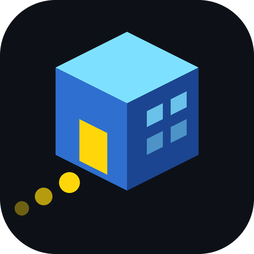
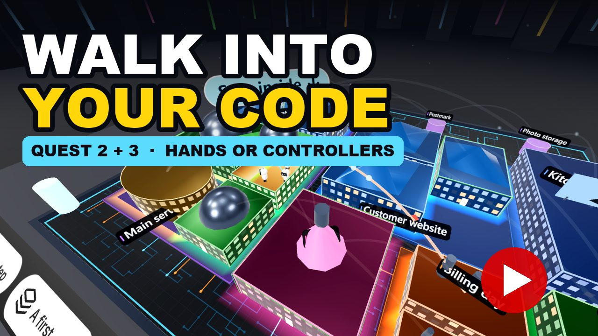
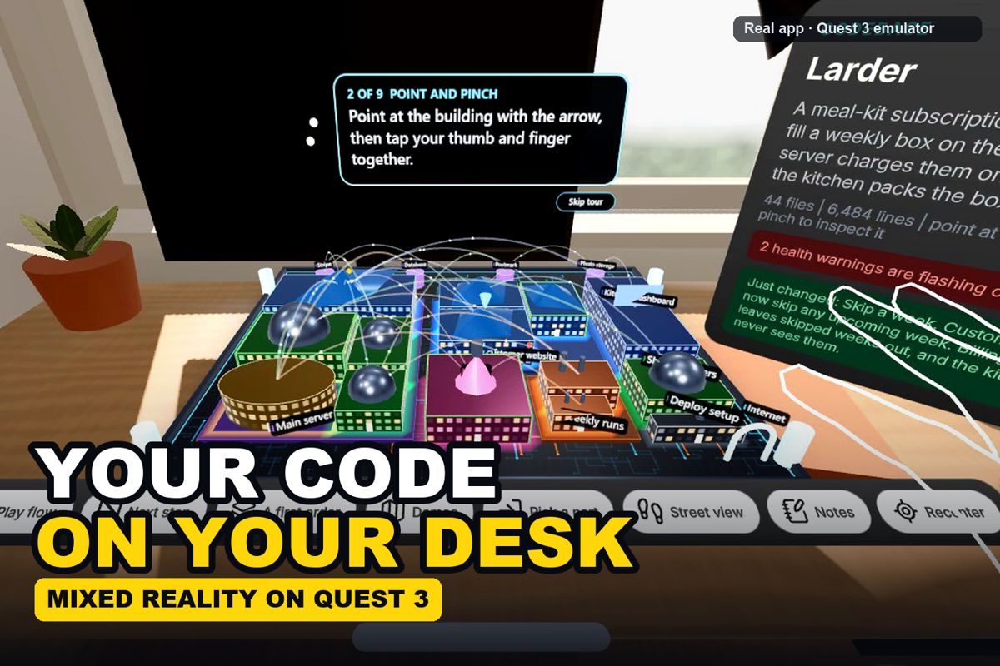
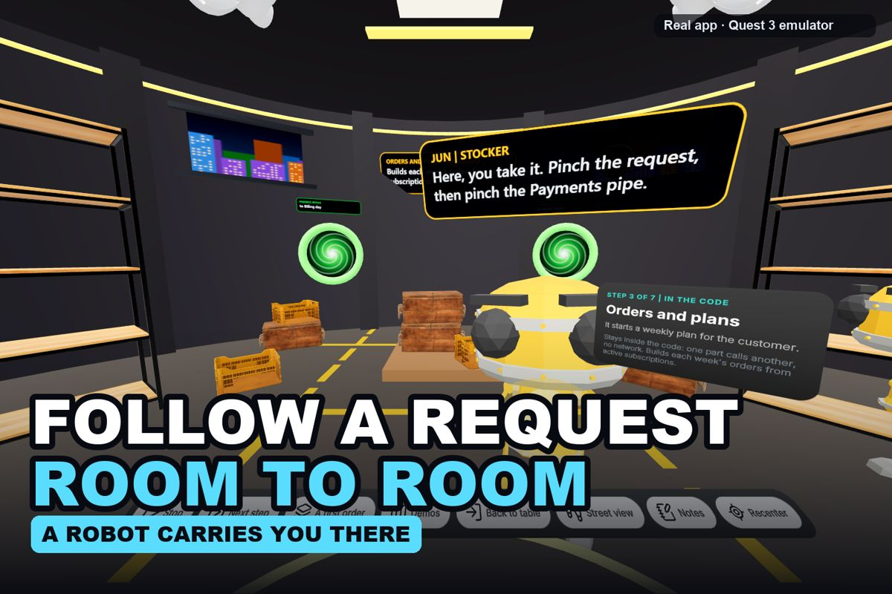
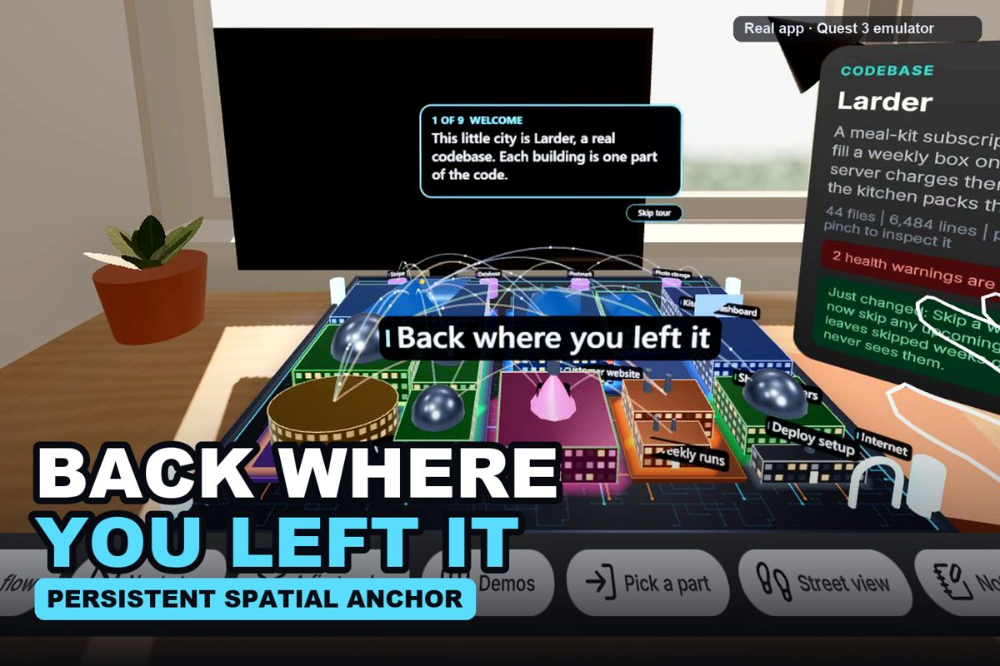
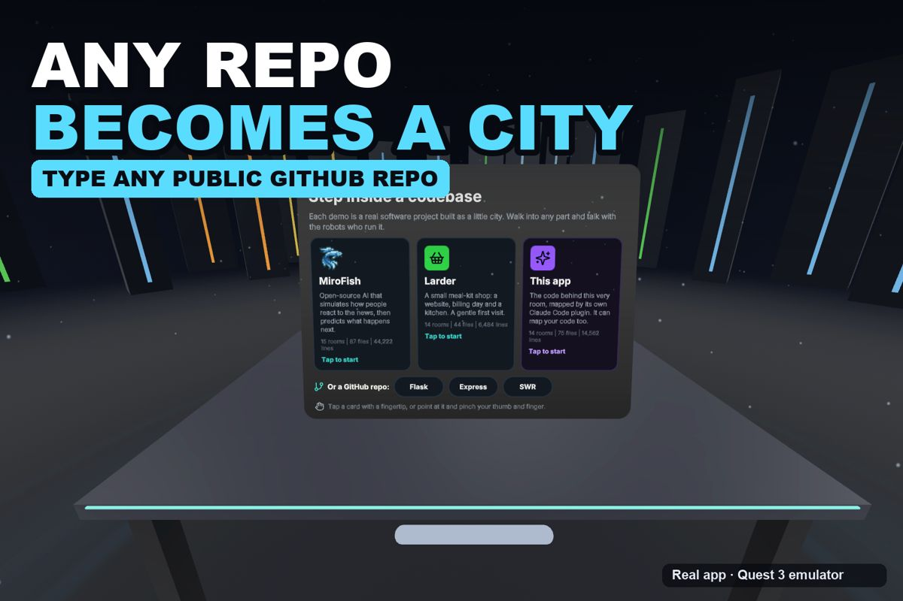

<p align="center">
  
</p>

<h1 align="center">Walkthrough</h1>

<p align="center">
  <strong>Take a walk through any codebase.</strong><br />
  Software becomes a little city on your desk: pinch a building, walk in, and ask the robots who run it how it works.
</p>

<p align="center">
  <a href="https://walkthrough.calebluh.com"><strong>Try it live</strong></a> ·
  <a href="https://youtu.be/5c6FPnVfjHU"><strong>Watch the demo</strong></a> ·
  <a href="https://github.com/calebluh/walkthrough"><strong>Plugin for your own code</strong></a>
</p>

<p align="center">
  <a href="https://youtu.be/5c6FPnVfjHU">
    
  </a>
</p>

Joining a codebase is like moving to a city with no map. The knowledge is
all there, spread over thousands of files, and the only way in is to read.
People don't learn places by reading. They learn them by walking around and
asking someone who works there. Walkthrough makes a codebase that place:
small enough to see whole on a desk, big enough to walk into, and staffed by
robots you can simply ask.

Built with [Meta IWSDK](https://iwsdk.dev) (WebXR) for the Meta VR Start
Developer Competition 2026. It runs from a link in the Quest Browser with
nothing to install. Everything works sitting down, with bare hands or
controllers: point and pinch, or poke the panels with a fingertip. On Meta
VR Glasses the desk moves to fit the narrower view, and a look and a pinch
do the same job.

**Try it:** open [walkthrough.calebluh.com](https://walkthrough.calebluh.com)
in the Quest Browser (Quest 2, 3 or 3S; mixed reality needs a Quest 3 or 3S).
Tap a demo, or type any public GitHub repository, such as `pallets/flask`,
and press **Build city**. About ten seconds later you can walk into it. A link
like `https://walkthrough.calebluh.com/?repo=facebook/react` opens a city
directly.

## What it does

<table>
  <tr>
    <td width="50%"></td>
    <td width="50%"></td>
  </tr>
</table>

- **The city.** Every part of the code is a building, sized by how much code
  it holds and joined to the parts it talks to. Pinch one and a panel says,
  in plain English, what it does, which files it holds and what is wrong
  with it.
- **Lift the roof.** The building you pinch opens like a doll's house, with
  the robots who work there inside and a **Step inside** button over them.
- **The rooms.** Step inside and the building grows around you. Each room is
  the real-world place that does the same job: payments is a cashier's
  office, storage is a warehouse, messaging is a post office.
- **Robots that act.** Ask out loud or pinch a question. A robot answers from
  the map and from the actual lines of code your question is about, in its
  own voice. It walks you to another room, plays a flow, or hands you to a
  colleague who already knows what you asked.
- **The code itself.** Say "show me the code" and the robot holds up the real
  function, coloured like an editor, with line numbers. Ask how to fix a
  warning and it lights the exact line and puts the fix on your notes list.
- **Flows.** **Play flow** sends a packet of data from building to building
  along a real path through the code, such as a first order in a shop.
- **Street view.** The city grows to life size around you. Pinch a glowing
  disc or **Forward** to walk, **Turn** to turn, and a building to go to its
  door.
- **Quiz me.** The robot tests you on its room and corrects a wrong answer on
  the spot.
- **The notes room.** Think out loud. The note taker writes your ideas down,
  looks each one up in the code and ends the note with the file and line to
  change. **Review this project for me** writes the three to five most urgent
  tasks.
- **Mixed reality.** On a Quest 3 or 3S the city lands on your real desk and
  stays where you left it between visits, held by a spatial anchor.
- **Your coding agent closes the loop.** With the
  [plugin](https://github.com/calebluh/walkthrough), the notes are saved in
  your repository as you say them. Your coding agent works through them, and
  you watch the city change in front of you.

## Gallery

<table>
  <tr>
    <td width="50%"></td>
    <td width="50%"></td>
  </tr>
  <tr>
    <td></td>
    <td></td>
  </tr>
  <tr>
    <td></td>
    <td></td>
  </tr>
  <tr>
    <td></td>
    <td></td>
  </tr>
  <tr>
    <td></td>
    <td></td>
  </tr>
</table>

<sub>All images are screenshots of the app running in the IWSDK Quest 3 emulator, with a headline added on top.</sub>

## Things to say to a robot

The robots act on what you ask, so most of a visit can be done by voice:

- "What happens in this room?"
- "Take me to the kitchen." (any room, by name or by what it is)
- "Where does the money go next? Take me there."
- "Show me what happens on billing day." (plays that flow)
- "Take me back to the city."
- "Quiz me." (four questions about the room; pinch an answer or say it)

Moving, playing a flow, leaving and the quiz also work with no AI key at
all; the key is only needed to mark a quiz answer said in your own words.

## Try it

```sh
npm install
npm run dev
```

The dev server prints a network URL. Open it in the Quest browser on the same
Wi-Fi, accept the local certificate warning, and press Enter VR. On a desktop,
the managed browser runs a headset emulator.

Optional keys go in `.env.local`, which stays on your machine:

```sh
MODEL_API_KEY=LLM_...      # Meta Model API (dev.meta.ai): the robots' answers and speech recognition
OPENAI_API_KEY=sk-...      # natural robot voices; without it the browser's voice is used
```

Without a Meta key the robots still talk, using canned answers built from the
map.

## Map your own codebase with your coding agent

The `walkthrough` plugin teaches a coding agent to map any repository. It
reads the repo without running it and names its parts in plain English. It
describes every file, traces the main flows and notes real issues. Then it
builds the map and starts this viewer with your own key.

In Claude Code:

```sh
claude plugin marketplace add calebluh/walkthrough
claude plugin install walkthrough@walkthrough
```

Then, inside the repository you want to see, ask Claude Code:

```text
/walkthrough:map
```

The same skill is packaged for Codex and the ChatGPT desktop app, Cursor,
Gemini CLI, Antigravity, GitHub Copilot and others. The install line for each
is in the README of [calebluh/walkthrough](https://github.com/calebluh/walkthrough).
The packaging follows each tool's published format and has been installed
only in Claude Code so far.

## Two repositories

- **This one, [meta-start-hackathon](https://github.com/calebluh/meta-start-hackathon),**
  is the competition build. It opens on a start menu of three demo
  codebases: MiroFish, Larder, and "This app", Walkthrough's own source
  mapped by its own plugin.
- **[walkthrough](https://github.com/calebluh/walkthrough)** is the
  public viewer and the plugin for coding agents, and it is what the plugin installs.
  It has no demo menu and no MiroFish. It opens straight onto your own maps.

To preview the public edition from this repository, add `VITE_EDITION=personal`
to `.env.local`.

## How it is built

- `src/diorama.ts`: the tabletop city, its connections, flows and panels.
- `src/rooms/`: the walk-in rooms, their themes, props and robot workers.
- `src/agent/` and `server/`: the robots' conversations. Prompts are built on
  the server from the map and the lines of code a question is about, so the
  page never sees an API key.
- `src/guide-system.ts`, `src/menu.ts`, `src/atmosphere.ts`,
  `src/transition.ts`: the guided first visit, the start menu, the
  surroundings and the dive into a building.
- `scripts/build-map.mjs`: turns a repo plus a hand-written map into a map
  file (Floorplan's `floorplan/graph@1` format).

## Credits

- Demo codebase: [MiroFish](https://github.com/666ghj/MiroFish) (AGPL-3.0),
  mapped from a read-only snapshot. Its logo appears on the map's plaque.
- Map format: [Floorplan](https://github.com/haydenschmitty/floorplan) (MIT).
- Robot: "RobotExpressive" by Tomás Laulhé (Quaternius), CC0, via the
  three.js examples.
- Props: [Poly Haven](https://polyhaven.com), CC0. See
  `public/models/props/CREDITS.md`.
