<p align="center">
  
</p>

<h1 align="center">Walkthrough</h1>

<p align="center">
  <strong>Take a walk through any codebase.</strong><br />
  Software becomes a little city on your desk: pinch a building, walk in, and ask the robots who run it how it works.
</p>

<p align="center">
  <a href="https://walkthrough.calebluh.com"><strong>Try it live</strong></a> ·
  <a href="https://youtu.be/5c6FPnVfjHU"><strong>Watch the demo</strong></a> ·
  <a href="https://github.com/calebluh/walkthrough"><strong>Plugin for your own code</strong></a>
</p>

<p align="center">
  <a href="https://youtu.be/5c6FPnVfjHU">
    
  </a>
</p>

**Try it:** open [walkthrough.calebluh.com](https://walkthrough.calebluh.com)
in the Quest Browser. Tap a demo, or type any public GitHub repository, such
as `pallets/flask`, and press **Build city**. About ten seconds later you can
walk into it. A link like `https://walkthrough.calebluh.com/?repo=facebook/react`
opens a city directly.

## Inspiration

I am a huge hands-on learner. I remember when VR first gained traction, the commercials always showcased virtual cities or diagrams people could step inside to get "hands-on" with their learning. In the 10+ years since seeing those ads, I have graduated college with a degree in IT and spent much of my time in and out of college coding. I thought it would be cool to actually live in the world of your codebase and talk to the "people" who make it work.

## What it does

Walkthrough transforms your complex, 2D software repository into a living, miniature 3D city on your desk. Instead of scrolling through thousands of lines of spaghetti code, you can physically lean in, pinch the roof off a building (a module), and step inside to talk to the AI "worker robots" managing that code.

The robots don't just read summaries, they are grounded in your actual source code. You can ask a robot why an API is failing, and it will diagnose the health warning, cite specific line numbers, and suggest a fix. If you like the suggestion, you just say "Put that on my fix list," and the robot logs it to a persistent Notes room. When you're done, the Notes room hands you a prioritized work order to copy straight into your coding agent, and with the plugin it is also written to `walkthrough/notes.md` in your project. The file works both ways: tick an item off (`- [x]`), by hand or through the plugin's tools for your coding agent, and your ticks are kept when the headset adds new notes.

Joining a new project means days of reading unfamiliar code. Walkthrough turns that into a seated, hands-first session: you see how the parts fit, ask the robots who run each part, and leave with a work order your coding agent can act on. It fits a recurring moment in every developer's week: "I need to understand this codebase before I change it."

Every room is staffed by a voice-first robot agent that answers from the real code of its part of the app. It reads the lines a question is about, points to the exact line on a code card, hands you off to the robot in another room, and turns your ideas into a work order for your coding agent (Claude Code, Codex, Cursor). Nothing is scripted, the answers come from the code.

## Gallery

<table>
  <tr>
    <td width="50%" valign="top">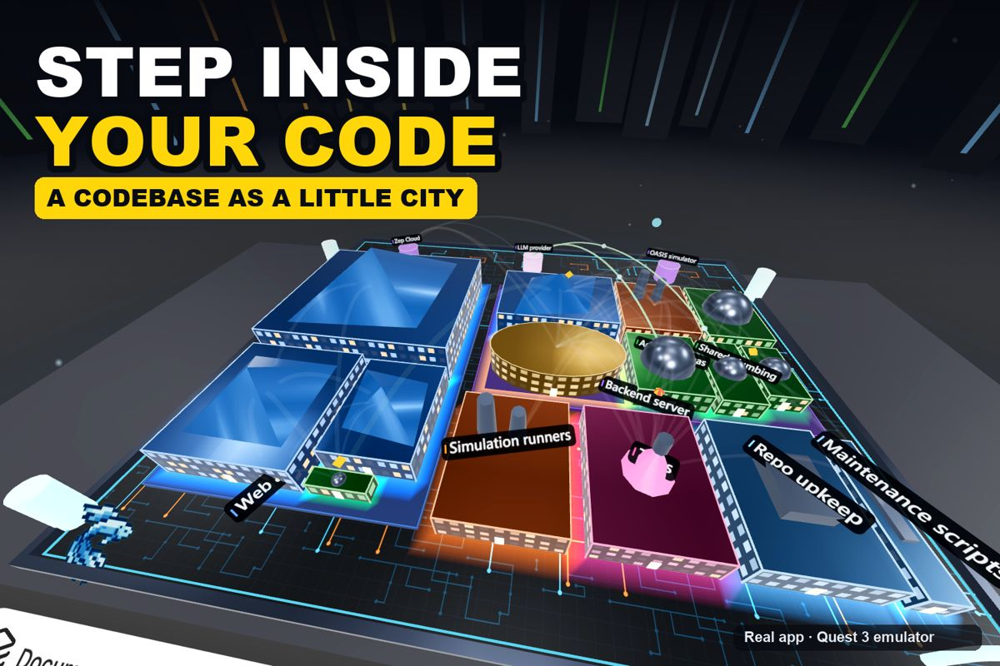<br /><sub>A software project as a glowing miniature city on your desk. Every building is one part of the code.</sub></td>
    <td width="50%" valign="top"><br /><sub>Pick a demo codebase, or type any public GitHub repository and get a city about ten seconds later.</sub></td>
  </tr>
  <tr>
    <td valign="top">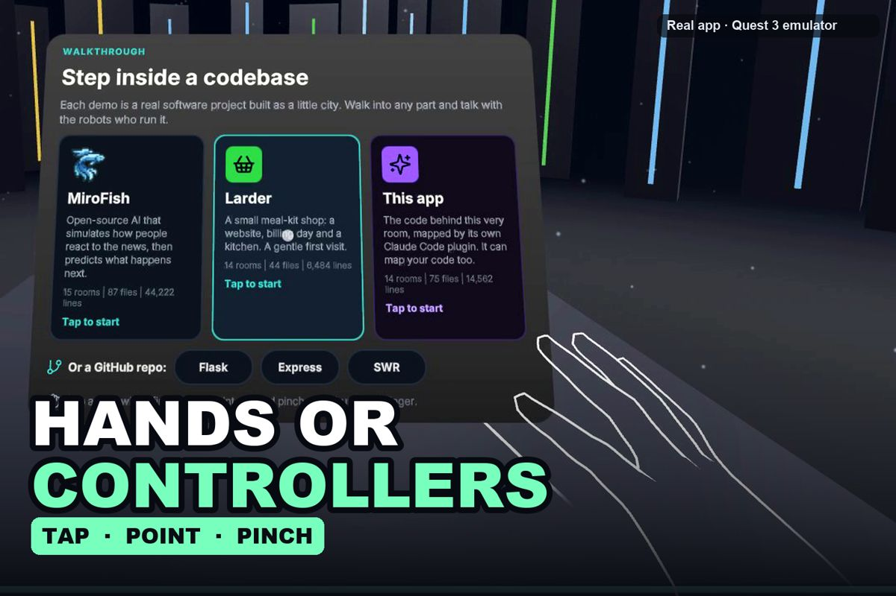<br /><sub>Everything works with bare hands or controllers: tap a card with a fingertip, point and pinch to pick things.</sub></td>
    <td valign="top"><br /><sub>In mixed reality the city stands on your real desk.</sub></td>
  </tr>
  <tr>
    <td valign="top">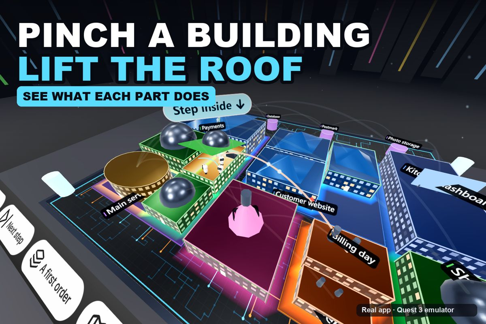<br /><sub>Pinch a building and its roof lifts to show the robots working inside, with a plain-English summary beside it.</sub></td>
    <td valign="top">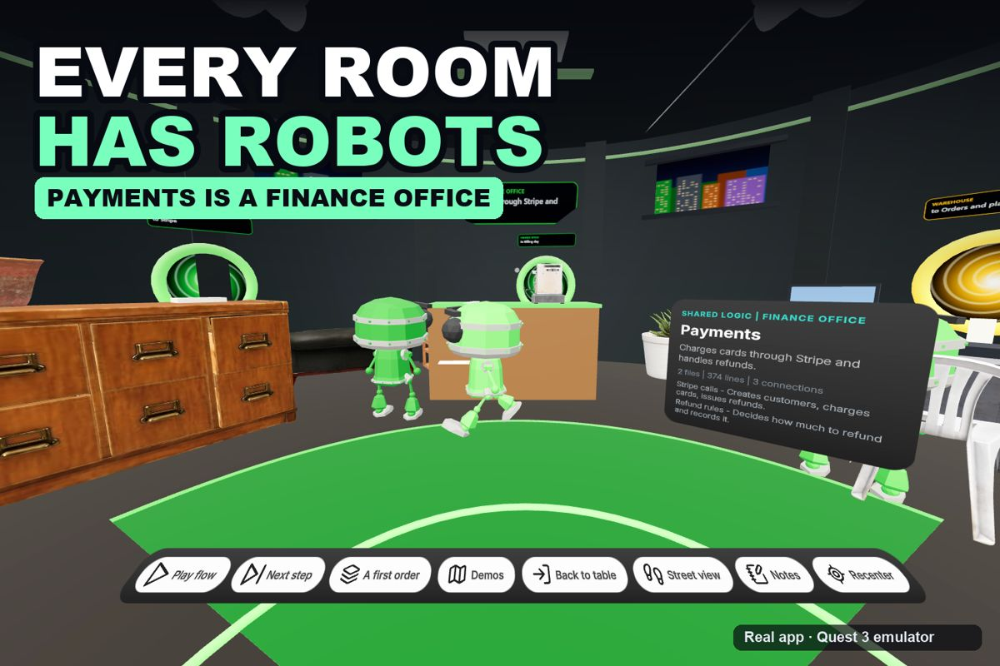<br /><sub>Step inside: each room is the real-world place that does the same job. Payments is a finance office.</sub></td>
  </tr>
  <tr>
    <td valign="top">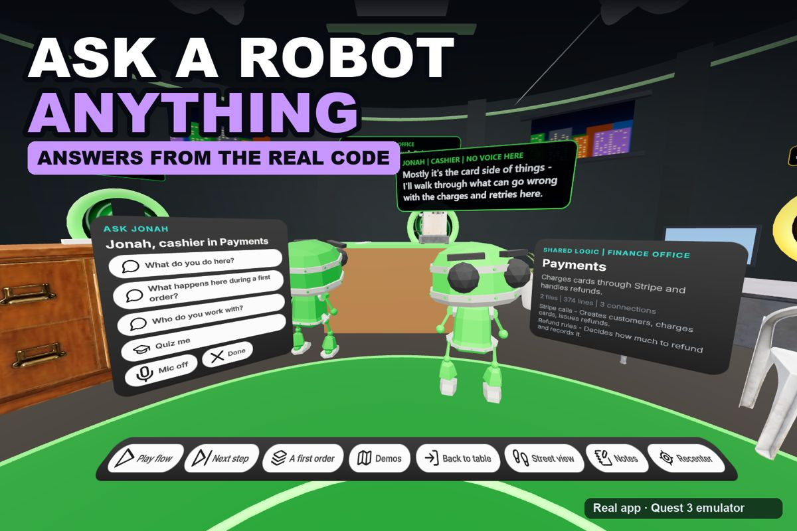<br /><sub>Ask a robot a question by voice or by pinching one from the list; it answers from the actual code.</sub></td>
    <td valign="top">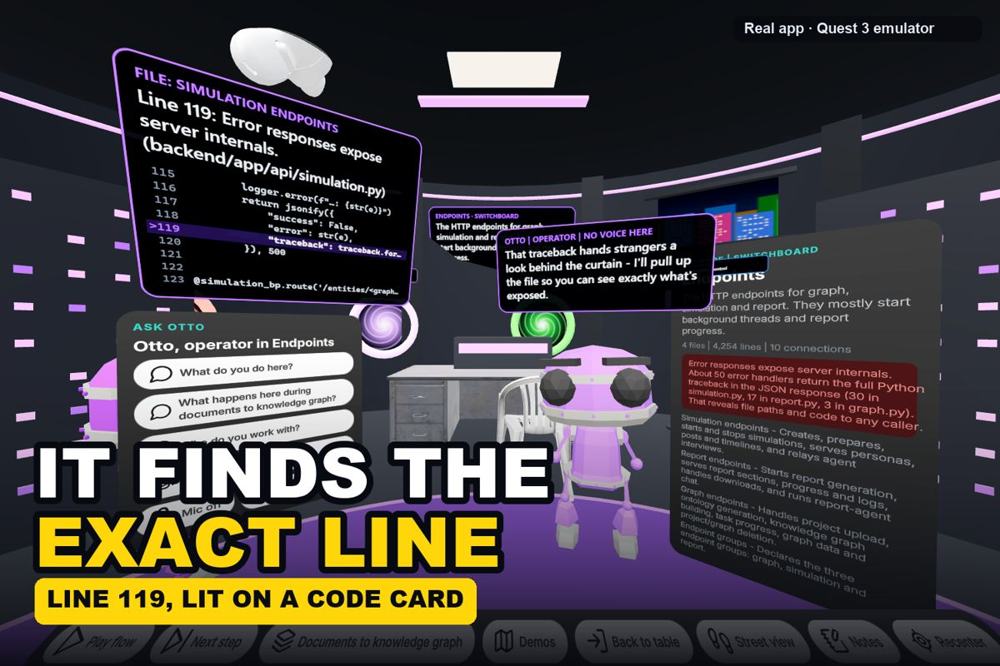<br /><sub>Ask how to fix a health warning and the robot opens a code card with the exact line lit, then puts the fix on your notes list.</sub></td>
  </tr>
  <tr>
    <td valign="top"><br /><sub>Follow a request from room to room: a robot hands you on to the colleague who knows the next step.</sub></td>
    <td valign="top">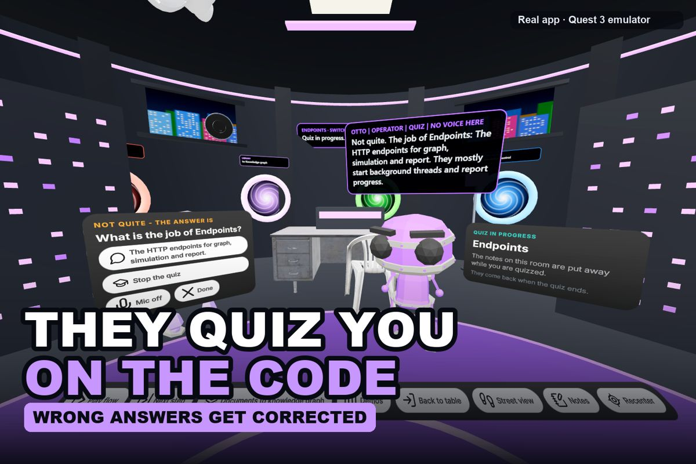<br /><sub>Say "quiz me" for four questions about the room. A wrong answer is corrected on the spot.</sub></td>
  </tr>
  <tr>
    <td valign="top">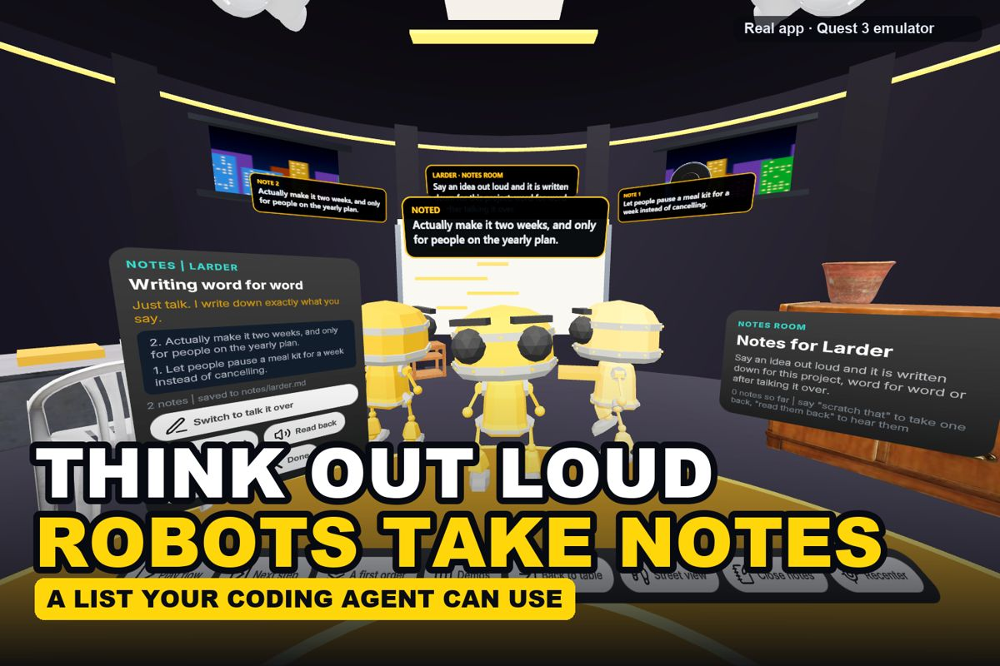<br /><sub>In the notes room, say an idea out loud and the note taker writes it down, word for word or after talking it over with you.</sub></td>
    <td valign="top">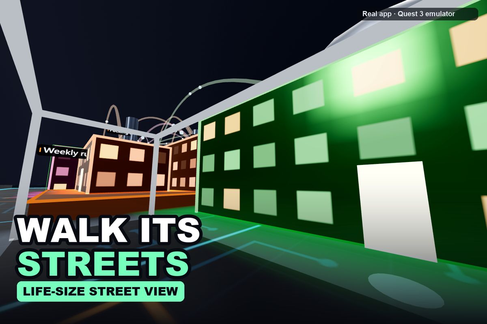<br /><sub>Street view puts you in the city at life size, still seated: pinch a disc or Forward to move, a building to go to its door.</sub></td>
  </tr>
  <tr>
    <td valign="top"><br /><sub>In mixed reality the headset keeps a spatial anchor, so the city comes back exactly where you left it.</sub></td>
    <td valign="top">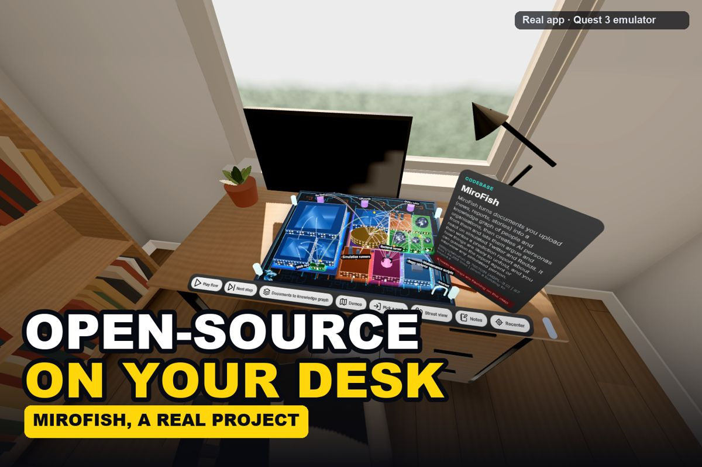<br /><sub>MiroFish, a real open-source project, mapped as a city beside the monitor.</sub></td>
  </tr>
  <tr>
    <td valign="top">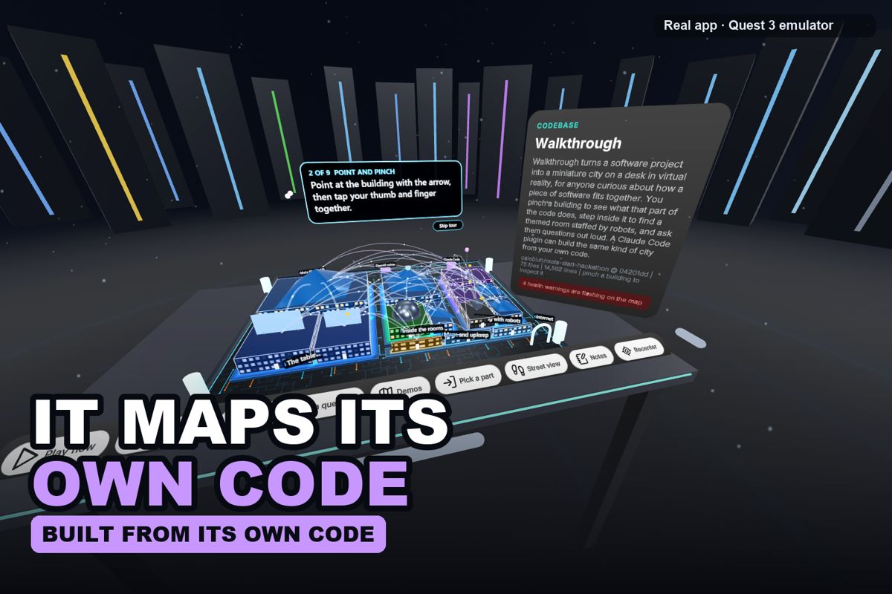<br /><sub>Walkthrough maps its own code too: this is the city built from the app's own repository.</sub></td>
    <td valign="top"></td>
  </tr>
</table>

<sub>All images are screenshots or frames of the app running in the IWSDK Quest 3 emulator, with a headline added on top.</sub>

## How we built it

Built for Meta Quest with the Immersive Web SDK (IWSDK) and WebXR, so it runs in the Quest Browser with nothing to install: on Quest 3 and 3S, and in VR and mixed reality (black-and-white passthrough) on Quest 2.

In mixed reality, Walkthrough uses WebXR plane detection (the browser's access to the headset's scene understanding) to find your desk and set the city on it, then saves a persistent spatial anchor so the city comes back to the same spot next time. This was tested in the IWSDK emulator and in a real room on a Meta Quest 2. Quest 3 hardware testing is next. The entire app is 100% controller-free, relying on bare-hand pinch gestures, hand rays, and UI panels that move to a comfortable reach distance for seated fingertip tapping. The experience works just as well with controllers though, for those who prefer the granularity of the controllers.

The mapping side is a Claude Code plugin that reads a repository and generates a spatial map of its parts, files and flows, with real code snippets. You can also type any public GitHub repo on the landing page, or pinch one of the one-tap repo chips inside the VR menu, to build a live city in seconds without taking off the headset (repos up to about 110 MB, including React and VS Code).

Inside the headset, the robots run on the Meta Model API (muse-ember-1.0), with serverless endpoints for speech-to-text and the robots' voices. The model answers in about 1.2 seconds, which keeps conversations feeling snappy and alive.

## Challenges we ran into

My biggest challenge was shortening the reply times from the agents. I profiled the pipeline and switched the robots' model to muse-ember-1.0, which cut the model's response time by about 70% (from about 4.2 s to 1.2 s). I also had to keep an open microphone honest, so a robot's own voice is never mistaken for yours.

Getting UI panels to feel right without blocking the miniature city was also a challenge. I built a dynamic reach system where panels move to a comfortable distance for seated fingertip tapping, angled so pinches and taps land reliably.

## Accomplishments that we're proud of

I designed a large, complex architecture visualization tool that can be navigated entirely within a 2-foot seated radius without ever picking up a controller. I am incredibly proud that this tool isn't just a thin wrapper that spits your own code back at you, you can actually interact with the codebase on all levels to understand the "whos", "whats", "whys", and "hows" of the way things work.

## What we learned

Giving code a physical, spatial location helps developers map complex dependencies intuitively. When a robot points to a glowing data pipeline crossing the street to another building, you understand the architecture instantly.

Also, latency is everything. If a spatial agent takes more than 1.5 seconds to respond to a voice command, they stop feeling like a "person" in the room and revert to feeling like a chatbot. Aggressive prompt optimization and fast models are non-negotiable for immersive AI.

## What's next for Walkthrough

I want to close the loop even further. As your local coding agent completes the tasks generated from your VR Notes room, the 3D buildings will visibly morph, rebuild, or glow in real time without you ever having to take off the headset.

I also plan to add asymmetric multiplayer so a senior engineer can jump into the diorama alongside a junior developer to give them a guided tour of a massive enterprise monolith.

## Things to say to a robot

The robots act on what you ask, so most of a visit can be done by voice:

- "What happens in this room?"
- "Take me to the kitchen." (any room, by name or by what it is)
- "Where does the money go next? Take me there."
- "Show me what happens on billing day." (plays that flow)
- "Take me back to the city."
- "Quiz me." (four questions about the room; pinch an answer or say it)

Moving, playing a flow, leaving and the quiz also work with no AI key at
all; the key is only needed to mark a quiz answer said in your own words.

## Run it locally

```sh
npm install
npm run dev
```

The dev server prints a network URL. Open it in the Quest browser on the same
Wi-Fi, accept the local certificate warning, and press Enter VR. On a desktop,
the managed browser runs a headset emulator.

Optional keys go in `.env.local`, which stays on your machine:

```sh
MODEL_API_KEY=LLM_...      # Meta Model API (dev.meta.ai): the robots' answers and speech recognition
OPENAI_API_KEY=sk-...      # natural robot voices; without it the browser's voice is used
```

Without a Meta key the robots still talk, using canned answers built from the
map.

## Map your own codebase with your coding agent

The `walkthrough` plugin teaches a coding agent to map any repository. It
reads the repo without running it and names its parts in plain English. It
describes every file, traces the main flows and notes real issues. Then it
builds the map and starts this viewer with your own key.

In Claude Code:

```sh
claude plugin marketplace add calebluh/walkthrough
claude plugin install walkthrough@walkthrough
```

Then, inside the repository you want to see, ask Claude Code:

```text
/walkthrough:map
```

The same skill is packaged for Codex and the ChatGPT desktop app, Cursor,
Gemini CLI, Antigravity, GitHub Copilot and others. The install line for each
is in the README of [calebluh/walkthrough](https://github.com/calebluh/walkthrough).
The packaging follows each tool's published format and has been installed
only in Claude Code so far.

## Two repositories

- **This one, [meta-start-hackathon](https://github.com/calebluh/meta-start-hackathon),**
  is the competition build. It opens on a start menu of three demo
  codebases: MiroFish, Larder, and "This app", Walkthrough's own source
  mapped by its own plugin.
- **[walkthrough](https://github.com/calebluh/walkthrough)** is the
  public viewer and the plugin for coding agents, and it is what the plugin installs.
  It has no demo menu and no MiroFish. It opens straight onto your own maps.

To preview the public edition from this repository, add `VITE_EDITION=personal`
to `.env.local`.

## Code layout

- `src/diorama.ts`: the tabletop city, its connections, flows and panels.
- `src/rooms/`: the walk-in rooms, their themes, props and robot workers.
- `src/agent/` and `server/`: the robots' conversations. Prompts are built on
  the server from the map and the lines of code a question is about, so the
  page never sees an API key.
- `src/guide-system.ts`, `src/menu.ts`, `src/atmosphere.ts`,
  `src/transition.ts`: the guided first visit, the start menu, the
  surroundings and the dive into a building.
- `scripts/build-map.mjs`: turns a repo plus a hand-written map into a map
  file (Floorplan's `floorplan/graph@1` format).

## Credits

- Demo codebase: [MiroFish](https://github.com/666ghj/MiroFish) (AGPL-3.0),
  mapped from a read-only snapshot. Its logo appears on the map's plaque.
- Map format: [Floorplan](https://github.com/haydenschmitty/floorplan) (MIT).
- Robot model: "RobotExpressive" by Tomás Laulhé (Quaternius), CC0, via the
  three.js examples. Props: [Poly Haven](https://polyhaven.com), CC0. See
  `public/models/props/CREDITS.md`.
- Robot answers and speech-to-text: Meta Model API. Robot voices: OpenAI
  gpt-4o-mini-tts.
- Demo video music: "Education Music" by Alec Koff Label, used under its terms
  for non-monetized YouTube videos. Sound effects: "20 Cinematic Whoosh Sound
  Effects (No Copyright)" by The Bhavya Shah; boing by ammoclub; "Ooh" by
  Eccentric Sounds.
